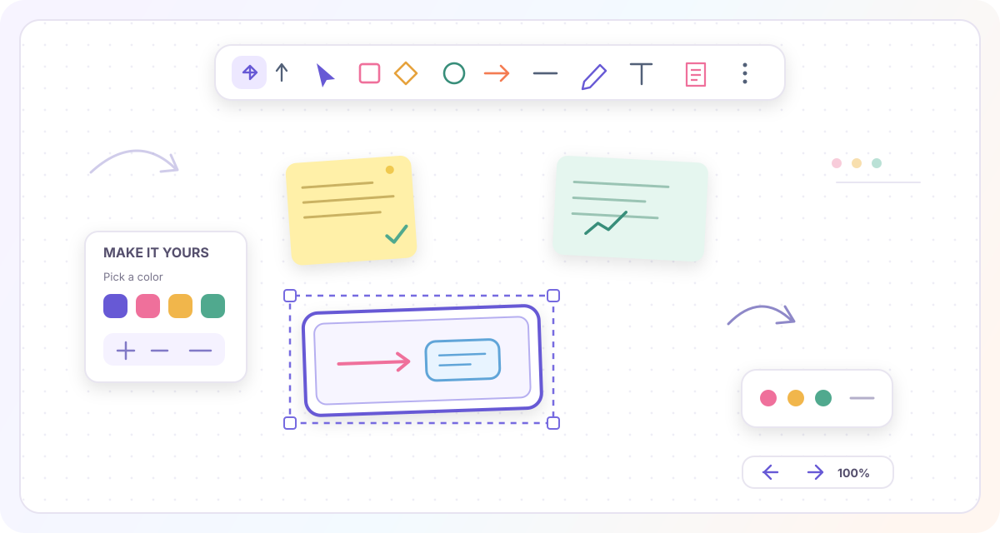

# My Whiteboard

**A colorful, browser-based canvas for sketching ideas, diagrams, and notes.**

*Click the image or a badge to jump to a section.*

---

## ✨ Features

| | |
|---|---|
| 🖊️ **Draw your way** | Sketch freehand, or add rectangles, ellipses, diamonds, lines, and arrows. |
| 📝 **Add notes and text** | Put labels, reminders, and explanations right on the canvas. |
| 🎨 **Style as you go** | Change color, fill, stroke, roughness, opacity, and layer order with contextual controls. |
| 🧲 **Select as a group** | Double-click empty canvas, then hold and drag to marquee-select multiple items. Move or resize the selection together. |
| 🪢 **Lasso selection** | Draw around objects to select them. |
| 🖼️ **Bring in visuals** | Insert an image from your device or embed a web page. |
| 🔎 **Explore a big canvas** | Pan around and zoom from **10% to 3000%**. |
| ↩️ **Undo and redo** | Step backward and forward through your edits. |
| 💾 **Keep your board** | Your board is saved automatically in this browser. |

  
  
  
  

## 🚀 Get started

1. Download or clone this project.
2. Open `index.html` in a modern browser.
3. Pick a tool from the toolbar and start creating.

No package installation or build step is required.

> **Your data stays in this browser.** The board is saved in local storage, so it is available on this browser and device. Clearing site data or switching browsers removes access to that saved copy.

## 🧰 Tools

### Drawing tools

Use the toolbar to select the hand, selection, rectangle, diamond, ellipse, arrow, line, freehand pen, text, note, eraser, or remove tool.

Open **More tools** for image insertion, frames, web embeds, draw-to-shape, laser pointer, bucket fill, lasso selection, and undo/redo.

### Selection

- Click an object with **Select (V)** to select and move it.
- To select a group, click empty canvas twice in quick succession, then hold the second click and drag a rectangle around the objects. The range outline appears while dragging.
- Release to keep the objects selected; drag the group to move it or use its corner handles to resize it.
- Hold **Shift** while clicking to add or remove individual objects from the selection.
- Choose **Lasso selection** from More tools and draw around objects to select them.
- Click empty canvas to clear the selection and return to **Select (V)**.

### Style controls

Select a tool or object to see the style options that apply to it. Depending on the selection, adjust stroke or text color, background and fill, line width, line style, roughness, shape edges, opacity, and layer order.

### Canvas and history

- Pan with the hand tool, hold **Space** while dragging, or use the middle mouse button.
- Zoom with the **− / +** controls or **Ctrl + mouse wheel**. Zoom is limited to **10%–3000%**.
- Use the undo and redo buttons, or their keyboard shortcuts below.

## ⌨️ Keyboard shortcuts

| Key | Action |
|:---:|---|
| `H` | Hand / pan |
| `V` | Select |
| `R` | Rectangle |
| `D` | Diamond |
| `O` | Ellipse |
| `A` | Arrow |
| `L` | Line |
| `P` | Freehand pen |
| `T` | Text |
| `N` | Note |
| `E` | Eraser |
| `F` | Frame |
| `K` | Laser pointer |
| `B` | Bucket fill |
| `9` | Insert image |
| `Shift + X` | Convert a drawing to a shape |
| `Ctrl + Z` | Undo |
| `Ctrl + Shift + Z` | Redo |
| `Ctrl + Y` | Redo |
| `Delete` / `Backspace` | Delete the selection |
| `Space` + drag | Pan the canvas |

## 📁 Project files

| File | Purpose |
|---|---|
| [`index.html`](./index.html) | Whiteboard interface and controls |
| [`style.css`](./style.css) | Layout, toolbar, panels, and responsive styling |
| [`app.js`](./app.js) | Canvas drawing, tools, selection, zoom, and persistence |
| [`whiteboard-preview.svg`](./whiteboard-preview.svg) | Illustrated README preview |

---

Made for colorful ideas. **Pick a tool and make something.**

